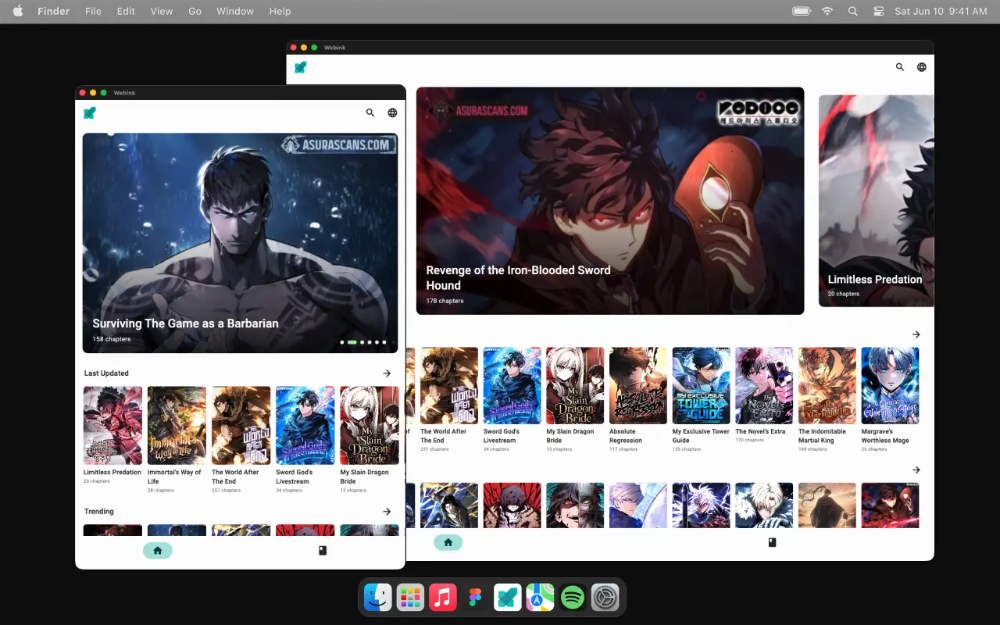
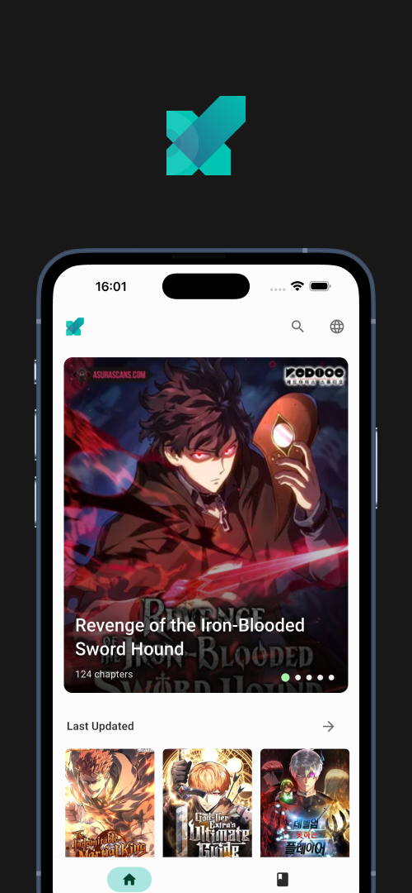
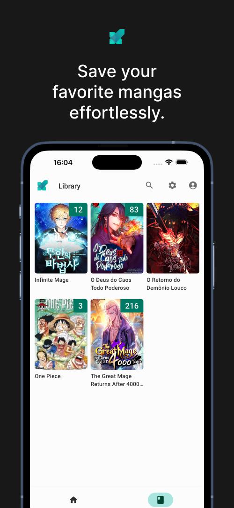
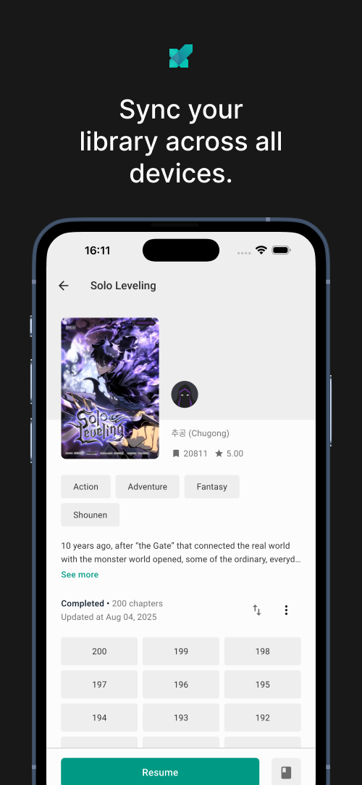
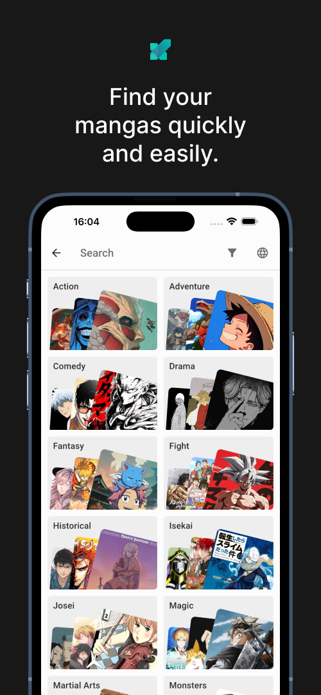
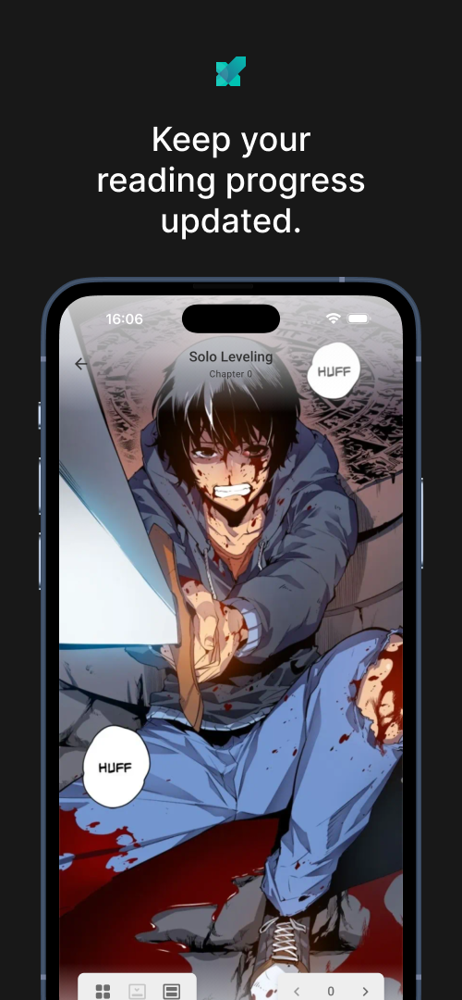
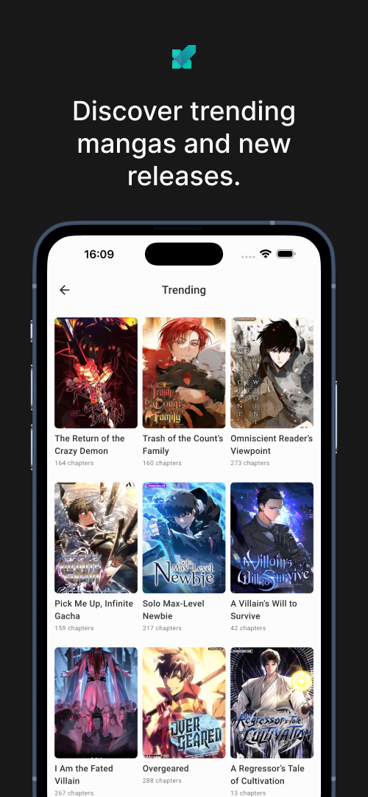

  

<h1 align="center">Webink</h1>

  A manga reader for iPhone, iPad, Android and macOS. 
  Discover manga across sources, keep your library together, and continue where you left off.

  <a href="https://buburo.com/webink/">Website</a> ·
  <a href="https://github.com/buburod/webink-releases/releases/latest">Latest releases</a> ·
  <a href="https://buburo.com/webink/install/">Installation guides</a>

&nbsp;&nbsp;

## Get Webink

  
  &nbsp;&nbsp;
  
  

  

  
  &nbsp;&nbsp;
  

&nbsp;&nbsp;

## What Webink does

- Browse new and trending manga from multiple supported sources.
- Search for titles across sources.
- Keep saved titles, reading status and chapter progress in one library.
- Sync your library across devices after signing in.

Webink is a reader for third-party sources. It does not host manga content.

## Mobile

  
  &nbsp;&nbsp;
  
  &nbsp;&nbsp;
  
  &nbsp;&nbsp;
  
  &nbsp;&nbsp;
  
  &nbsp;&nbsp;
  
  &nbsp;&nbsp;

&nbsp;&nbsp;

## Links

- [Webink website](https://buburo.com/webink/)
- [All releases](https://github.com/buburod/webink-releases/releases)
- [iOS and iPadOS install guide](https://buburo.com/webink/install/#ios)
- [macOS install guide](https://buburo.com/webink/install/#macos)
- [Android on Google Play](https://play.google.com/store/apps/details?id=com.buburo.webink)
